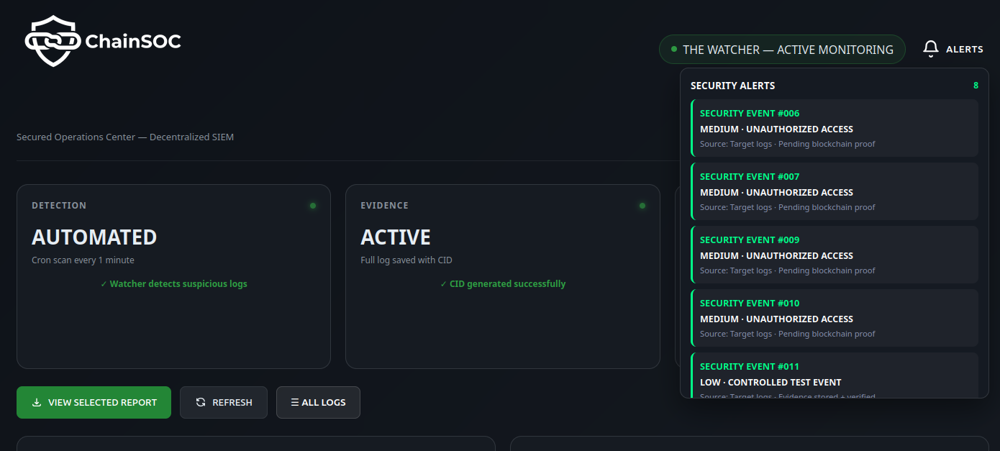
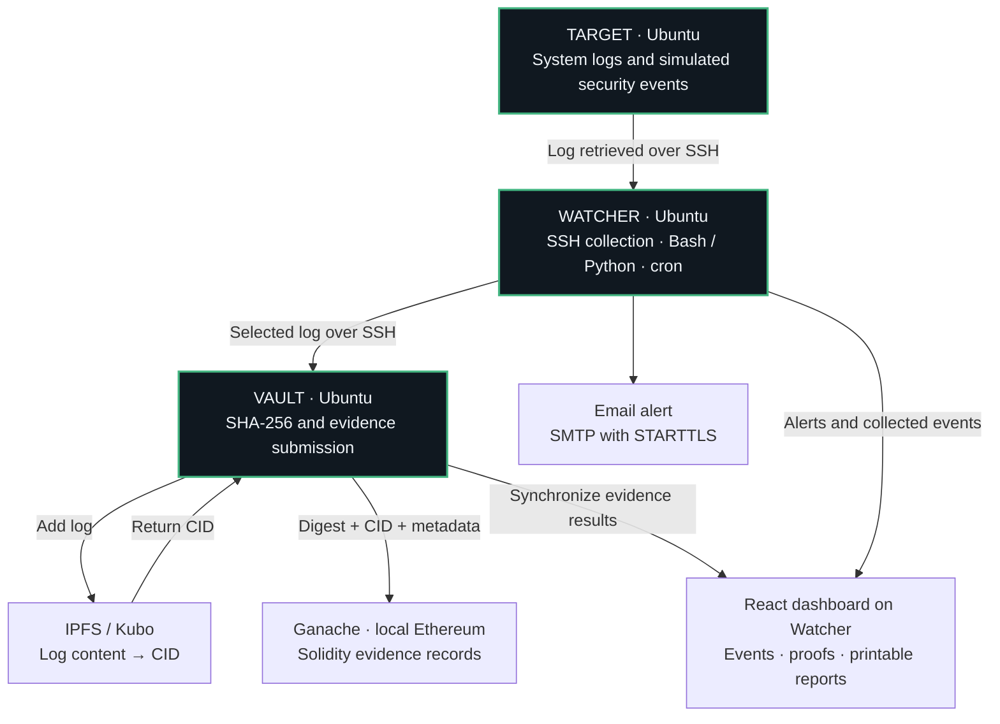
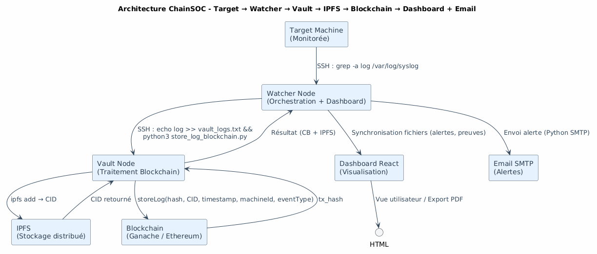
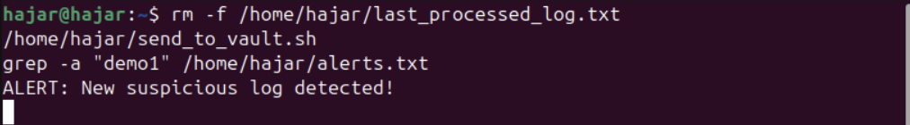
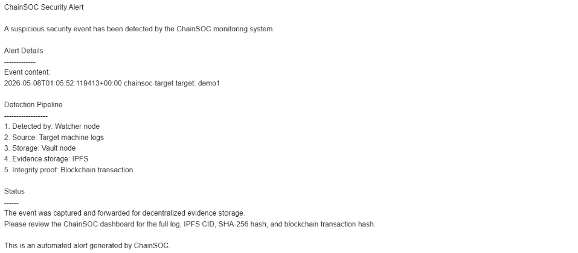
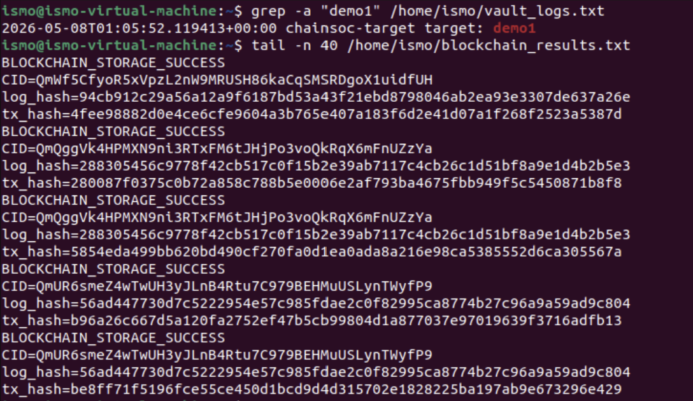
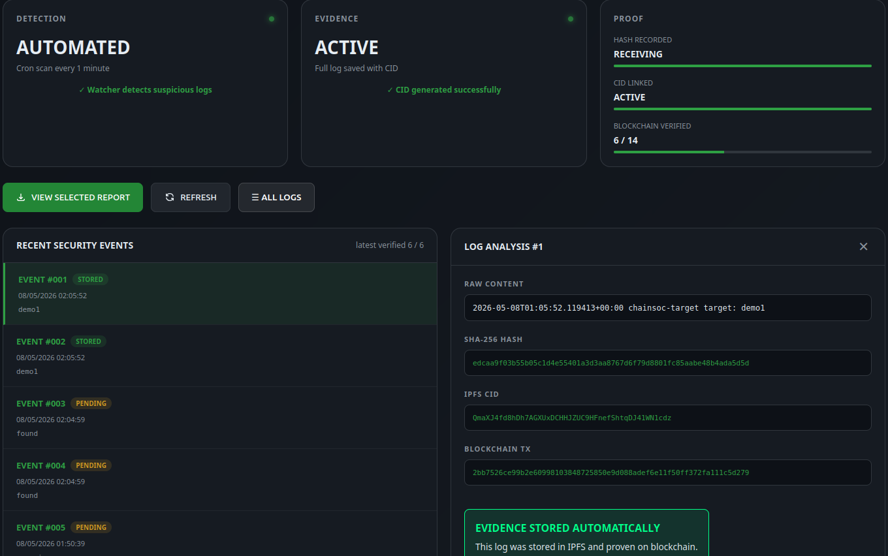
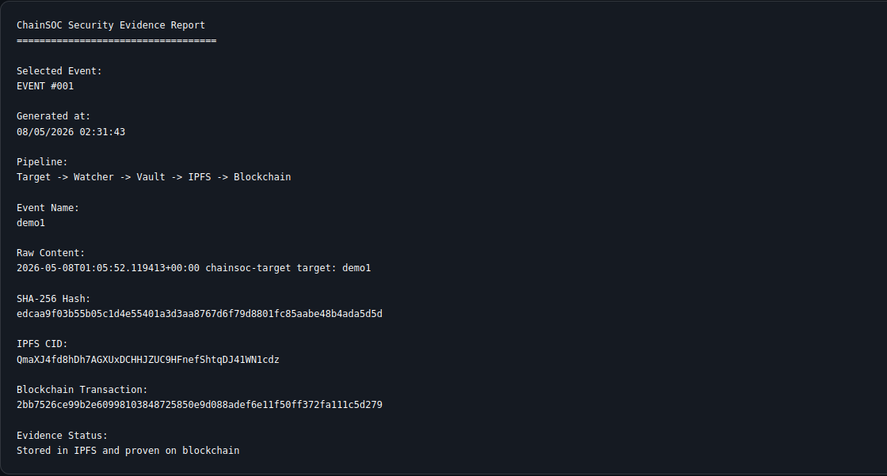

# ChainSOC

### Security events with a verifiable evidence trail

A three-machine SOC lab connecting Linux logs to IPFS storage and Ethereum smart-contract records.

[Architecture](#architecture) · [Demonstration](#security-testing-and-validation) · [Evidence dashboard](#monitoring-and-evidence) · [Technical notes](docs/implementation.md)

*The project's React dashboard. Alerts distinguish events awaiting blockchain proof from events with stored evidence.*

## Why I built this

An incident investigation depends on the logs behind it. If those logs change after collection, an analyst needs a way to detect the change and trace the original evidence.

ChainSOC explores that problem in a controlled Ubuntu lab. A **Target** produces security events, a **Watcher** collects selected events over SSH and sends an email alert, and a **Vault** stores the evidence in IPFS and records its digest and metadata in a Solidity contract on Ganache. A React dashboard brings the event and its evidence identifiers together.

The result is a documented proof of concept for linking a security event to a SHA-256 digest, an IPFS content identifier, and a local blockchain transaction.

> **Repository scope:** This is a technical case study assembled from the project report and presentation. It includes original screenshots and a documented YAML rule excerpt. The application, contract, and full automation source files were not supplied, so this checkout is not a runnable deployment. See [implementation status](docs/implementation.md#available-materials).

## Architecture

The Watcher polls the Target, identifies a matching log, and forwards it to the Vault. The Vault returns evidence results for display alongside the event. The report documents a one-minute cron schedule for collection and dashboard synchronization.

| Machine | Responsibility | Documented components |
| --- | --- | --- |
| Target | Produce logs and make them available over SSH | Ubuntu Server 24.04, OpenSSH, `logger`, Python test generator |
| Watcher | Collect, detect, alert, and present evidence | Ubuntu Desktop 22.04, Bash, Python, cron, SMTP, React |
| Vault | Store log content and record its evidence identifiers | Python, IPFS Kubo, Docker, Ganache, Solidity, Web3.py |

The lab uses bridged virtual networking and shows VMware Workstation in its screenshots. SSH protects the documented collection and transfer paths. The materials do not establish firewall zones or network segmentation. The Watcher remains the orchestration dependency, and the single Vault/local chain setup does not demonstrate high availability.

Original architecture diagram from the report

*Report figure 1.1. The Mermaid diagram above summarizes the documented implementation in English.*

## Implementation highlights

**Direct collection over SSH.** The documented Bash collector searches `/var/log/syslog` for a test marker and selects the latest match. It compares that line with `last_processed_log.txt` to avoid processing the same line again. This is a small lab collector with a clear limitation: selecting only the latest match can miss intervening events.

**Separate evidence storage and evidence records.** The Vault's `store_log_blockchain.py` is described as calculating SHA-256, adding content to IPFS, and recording the digest, CID, timestamp, machine ID, and event type in a smart contract. Remix screenshots show `storeLog(...)` and `getLog(0)` calls. Ganache provides the local Ethereum environment.

**Detection rules alongside the demonstration collector.** The report lists four YAML rules for failed passwords, failed sudo attempts, invalid users, and accepted root logins. The walkthrough demonstrates marker-based collection. It does not independently exercise all four rules.

| Documented rule | Pattern | Threshold | Window | Severity |
| --- | --- | --- | --- | --- |
| `brute_force_attack` | `Failed password` | 5 | 60 s | Critical |
| `suspicious_sudo` | `sudo.*FAILED` | 3 | 300 s | High |
| `invalid_user` | `Invalid user` | 3 | 60 s | High |
| `root_access` | `Accepted.*root` | 1 | Not specified | Critical |

The report's [YAML example](configs/security_rules.example.yaml) preserves the first rule. [Technical notes](docs/implementation.md) explain the scripts, scheduling, and missing deployment files.

## Security testing and validation

The documented walkthrough follows a synthetic `demo1` event through collection, email notification, Vault storage, and the dashboard. These are source-document observations, not tests rerun from this repository.

| Stage | Evidence in the materials | What it establishes |
| --- | --- | --- |
| Generate | Target terminal with `logger` | A controlled event was introduced |
| Detect | Watcher terminal reports a new suspicious log | The collector reached its alert path during a manual invocation |
| Notify | Received ChainSOC email | An alert reached the test inbox |
| Transfer | Vault log file contains `demo1` | The selected event reached the Vault |
| Record | Vault output lists CID, digest, and transaction hash | The script reported successful evidence storage |
| Inspect | Dashboard and printable report display evidence fields | The interface presents an event with its evidence identifiers |

*The Watcher screenshot shows a manual script run after resetting the last-processed marker. It supports the detection path, rather than a measured cron latency.*

*The received alert for the synthetic event. The crop excludes the sender address and inbox sidebar. Notification occurs before Vault storage in the documented collector, so receiving an email alone does not confirm a committed transaction.*

*Original Vault output, including repeated records. The terminal and dashboard captures do not provide a complete one-to-one mapping for every displayed proof. They should not be treated as an independently verified audit trail.*

The report also claims successful attack resistance and availability/scaling results. The supplied materials do not include enough procedures, raw results, or measurements to substantiate those claims here. The [validation record](docs/validation.md) separates screenshot evidence, reported behavior, simulation, and unverified claims.

## Monitoring and evidence

The custom React interface groups security alerts, recent events, and evidence details. Selecting an event exposes its raw content, SHA-256 digest, IPFS CID, and blockchain transaction identifier. The screenshot includes both **stored** and **pending** events.

*Event detail from the report. The visible partial verification count and pending rows remain intact.*

The printable evidence view gathers those fields into a report for investigation handoff. The source screenshot shows the browser's **Print / Save as PDF** view.

*The presentation's embedded demo also shows the print/save workflow. The screenshot above comes from the report for better readability.*

The report explicitly labels the dashboard's **STORE ON BLOCKCHAIN** control as a simulation in its UI description. The separate Vault and Remix evidence documents local blockchain interaction. Without the frontend source, every dashboard control's connection to that backend cannot be verified.

## What the integrity mechanism can establish

A digest recorded before a later modification gives a verifier a reference for checking the same bytes. An IPFS CID identifies content, while the contract associates evidence identifiers with metadata.

That mechanism depends on a trustworthy collection and verification path. It does not prove that the Target's original event was truthful, prevent an attacker from deleting a local file, or guarantee that IPFS content remains available. Ganache is a local development chain under lab control. Logs are stored in plaintext in this prototype.

## Challenges and lessons learned

- **Connecting three machines:** stable addressing and SSH keys were needed before the pipeline could run consistently.
- **Avoiding duplicate work:** a last-processed marker reduced repeat alerts, but the latest-line approach needs a durable cursor and retry handling for reliable ingestion.
- **Delivering notifications:** Gmail SMTP required an application password and STARTTLS on port 587.
- **Keeping the dashboard current:** separate synchronization joined the Watcher's alerts with the Vault's evidence results. A visible status must distinguish pending storage from confirmed evidence.
- **Separating integrity from availability:** a persistent identifier helps detect changed content. Retaining retrievable content requires its own storage and replication policy.

## Next steps

- Publish the original scripts, Solidity contract, ABI, and React source with credentials removed, then document a repeatable deployment.
- Encrypt logs before IPFS storage and define who can decrypt and retrieve them.
- Add durable ingestion, acknowledgments, and retries so bursts and partial failures do not lose evidence.
- Validate contract authorization and perform an explicit before/after tamper test against the recorded digest.
- Test a public testnet and replicated storage with measured recovery behavior.
- Extend incident handling through TheHive and add application or firewall event sources, as proposed in the report.

## Explore the repository

| Material | Contents |
| --- | --- |
| [Implementation notes](docs/implementation.md) | Component responsibilities, actual workflow, rule excerpt, and reconstruction gaps |
| [Validation record](docs/validation.md) | Demonstrated observations, limits, and proposed verification work |
| [Visual provenance](docs/visual-provenance.md) | Source pages, figures, crops, and selection decisions |
| [Assets](assets/) | Curated original architecture, dashboard, and testing images |

## Author and project context

Maintained by [Ismail Erraouidate](https://github.com/IsmailErra).

Developed with **Hajar Boudhih, Oumayma Benhilal, and Anass Messka** for the 2025–2026 Cryptography and Blockchain project in Computer and Network Engineering at **École Marocaine des Sciences de l'Ingénieur (EMSI)**. Supervised by **Pr. Saad Yasser Chadli**.

This case study draws on the team's French report and presentation. The full source documents remain outside the repository. No project license has been inferred from the licenses of the tools used.
