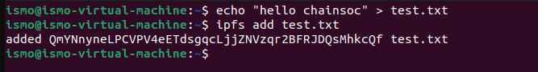
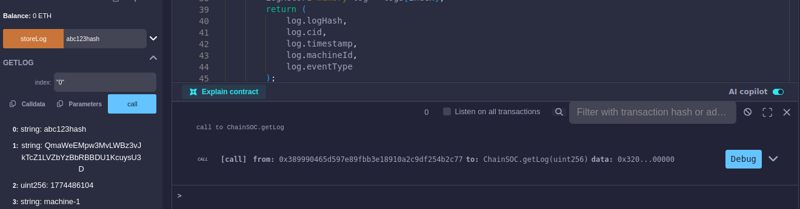

# Implementation notes

[Back to the case study](../README.md)

These notes describe the implementation documented in the supplied report and presentation. Commands and filenames identify the original lab workflow. They are not an installation guide for this checkout.

## Available materials

The GitHub repository had no commits or project files when this case study was prepared. The supplied materials were a 48-page PDF report and a 12-slide presentation containing a roughly 5 minute 27 second demo video.

Included here:

- A technical narrative and curated screenshots extracted from the report.
- The single YAML rule example printed in section 2.2.5, with indentation normalized.
- Evidence and source notes that identify what the materials demonstrate.

Not supplied as source files:

- Bash and Python collectors, synchronization scripts, or email implementation.
- The complete Solidity contract, ABI, deployment configuration, or chain state.
- React source, its dependency manifest, or a documented backend API.
- Raw logs, transaction receipts, IPFS exports, automated tests, or VM images.

The complete application cannot be built or tested from this checkout. No reconstructed executable implementation has been substituted for the team's original code.

## Target: event generation

The report describes Ubuntu Server 24.04, bridged networking, and SSH on port 22. Screenshots show failed SSH login attempts and generated security-event strings in `/var/log/auth.log`. A Python script named `generate_logs.py` emits simulated events. The final walkthrough uses `logger` to introduce a `demo1` marker into system logging.

The report uses both authentication logs and syslog across its examples. The final collector excerpt specifically reads `/var/log/syslog`. A generated string describing a port scan or failed sudo attempt is synthetic input, and does not by itself demonstrate an actual attack.

## Watcher: collection and orchestration

The Watcher is documented as Ubuntu Desktop 22.04 LTS with 4 GB RAM and a 25 GB disk in its detailed implementation section. Python 3, Node.js 18.x, React, Bash, cron, and Web3.py support the orchestration and interface. These are historical lab descriptions, not current installation recommendations.

The report's `send_to_vault.sh` excerpt performs this sequence:

1. Connect to the Target over SSH and retrieve the last syslog line containing `chainosc_test`.
2. Compare the result with `last_processed_log.txt` and exit if unchanged or empty.
3. Update the last-processed marker and append the event to `alerts.txt`.
4. Invoke `send_email_alert.py` with the selected event.
5. Connect to the Vault, append the event to `vault_logs.txt`, and invoke `store_log_blockchain.py`.

Section 2.2.8 schedules `send_to_vault.sh` and `sync_dashboard_data.sh` once per minute. The final screenshot demonstrates a manual collector invocation. The report's conclusion says detection occurred in under a minute, but no timing series accompanies that statement.

| Script named in the report | Documented purpose | Source availability |
| --- | --- | --- |
| `send_to_vault.sh` | Latest matching event, duplicate check, email, SSH transfer | Partial excerpt only |
| `send_email_alert.py` | Gmail SMTP, port 587, STARTTLS | Description only |
| `hash_log.py` | SHA-256 calculation | Description only |
| `incident_detector.py` | Detection using YAML rules | Description and rule table |
| `final_verification.py` | SSH and blockchain integrity checks | Description only |
| `sync_dashboard_data.sh` | Synchronize dashboard data | Cron reference only |
| `store_log_blockchain.py` | IPFS upload and contract submission on Vault | Description and output screenshots |

Nerdlog is discussed as an optional remote log viewer. The documented collector uses direct SSH commands. An early section mentions AlertManager, but the detailed implementation documents a Python SMTP script. No separate AlertManager deployment is established.

### Collector limitations visible in the excerpt

- `tail -1` selects a single matching line. Multiple events between polls can be skipped.
- The last-processed marker is written before email and Vault submission succeed. The excerpt does not show durable retries or delivery acknowledgments.
- The event text is interpolated into a remote shell command. Robust quoting and safe argument transport need review before reuse with arbitrary logs.
- A string comparison prevents immediate duplicate processing, but does not establish end-to-end exactly-once delivery. Repeated records remain visible in the evidence screenshots.

The shell excerpt is described rather than republished as a runnable deployment script because it contains lab-specific paths and incomplete failure handling.

### Detection rule excerpt

[security_rules.example.yaml](../configs/security_rules.example.yaml) transcribes the report's single example: five `Failed password` matches within 60 seconds, with critical severity and an alert action.

The four-rule table in the README comes from report table 2.5. The full rule file, detector schema, matching logic, and per-rule test results are unavailable. The marker-based Bash collector and the YAML detector are described separately in the report. Their integration cannot be confirmed from the supplied excerpts.

## Vault: storage and blockchain records

The report documents IPFS Kubo v0.27.0, an `ipfs daemon`, and an add/read exercise using a small `hello chainsoc` file. Its Docker example maps host port 7545 to the Ganache container's port 8545. Remix and MetaMask support local contract deployment and interaction.

*Report figure 2.11. This is a basic storage test, separate from the final incident walkthrough.*

The documented contract interface includes:

- `storeLog(logHash, cid, machineId, eventType)` to submit a record.
- `getLog(index)` to read a stored record.
- A record with a digest string, CID string, timestamp, machine ID, and event type.

*Report figure 2.18. The early contract exercise stores the literal `abc123hash`. That placeholder demonstrates record storage/readback, not a computed SHA-256 integrity check. Some returned fields extend beyond the source screenshot.*

The final walkthrough separately shows 64-character digest values, IPFS CIDs, and transaction identifiers in `blockchain_results.txt`. Without source code, contract state, or receipts, access controls and the association between all displayed records cannot be audited.

## Dashboard and notifications

The report describes a React build served on port 3000 using Python's HTTP server. Its screen captures show event history, alerts, evidence fields, pending/stored status, and a printable evidence report. The presentation's embedded video shows the same workflow and the print/save dialog.

Section 2.2.6 explicitly calls the dashboard's `STORE ON BLOCKCHAIN` action a simulation. The final interface captures show evidence data and automatic-storage status. These different interface descriptions do not establish that every control submits or verifies a live contract transaction.

The received email confirms delivery of a lab alert. Since the documented collector sends email before Vault submission, the message's pipeline description is not a storage acknowledgment.

## Network and security boundaries

The report includes addresses from both a `10.11.16.x` lab and a `192.168.233.x` lab. Its Watcher/Vault/Target examples use `.101`, `.102`, and `.103` in the latter subnet. These reflect differing lab examples, and should not be read as a single validated address plan.

The materials establish SSH transfers and describe SSH key setup. They do not establish firewall policies, VLANs, pfSense, IDS/IPS, Zabbix, or Grafana. The dashboard is a custom React interface.

Logs remain plaintext in IPFS. A CID is an identifier, not an access-control policy. Encryption, key management, content retention, contract write authorization, RPC access controls, and replication require further implementation evidence.

## Source reconciliation

| Difference in the materials | Interpretation used here |
| --- | --- |
| Early flow says Vault retrieves logs and Watcher later analyzes them | Prefer the detailed Watcher collector and the presentation's Target–Watcher–Vault flow |
| Both sources describe complete decentralization | Document distinct roles while retaining the Watcher and Vault as operational dependencies |
| Presentation says the machines communicate only over SSH | Apply SSH to the inter-machine log paths, while documenting SMTP and the Vault's IPFS/Ethereum interactions separately |
| Broad resource totals conflict with the detailed Watcher specification | Use detailed per-machine descriptions and omit aggregate sizing claims |
| Collector searches `chainosc_test`, walkthrough uses `demo1` | Preserve both labels and flag the missing exact configuration linking them |
| Report claims guaranteed immutability and attack prevention | Describe evidence comparison and the local-chain trust assumptions |

## Files needed for a reproducible release

The next useful contribution is the team's original implementation: scripts, contract and ABI, frontend source, dependency versions, and sanitized configuration templates. A release should also define exact log bytes and encoding, the detector-to-collector handoff, deployment addresses, receipt handling, and a repeatable verification procedure.

Source locations: report sections 1.3–1.6, 1.11–1.13, 2.1–2.2, and 3.1. The presentation's slide 8 and embedded demo corroborate the final data flow. See [visual provenance](visual-provenance.md).
